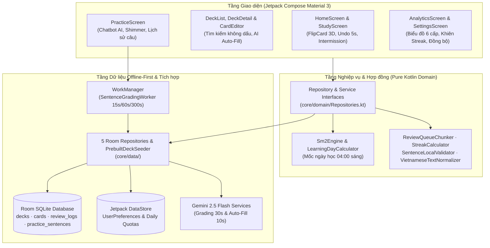

# 🧠 Memora — Ứng dụng Học Từ Vựng Lặp Lại Ngắt Quãng (SM-2) & Trợ Lý Đặt Câu AI

[-3DDC84?logo=android&logoColor=white)](https://developer.android.com)
[](https://kotlinlang.org)
[](https://developer.android.com/jetpack/compose)
[](#kiến-trúc-hệ-thống-architecture)
[](#2-trợ-lý-ai-gemini-điền-nhanh--chấm-câu-theo-khung-cefr)

> **Đồ án môn học Lập trình Thiết bị Di động** — Trường Đại học Giao thông Vận tải TP.HCM (**UTH**).  
> 🎨 **Thiết kế UI/UX trên Figma:** [Memora UI Design System & Screens](https://www.figma.com/design/N06oKR6Z3d1f1KIIdAIH5U/Memora-UI?node-id=0-1&t=CQsBEKTSjgdjsQDy-1)

---

## 📖 1. Tổng quan & Bài toán giải quyết

Theo nghiên cứu về **Đường cong quên lãng (Ebbinghaus Forgetting Curve)**, người học ngoại ngữ thường quên tới **70%–80%** từ vựng mới chỉ sau vài ngày nếu ôn tập dàn trải hoặc học vẹt. Ngoài ra, việc chỉ nhìn mặt thẻ khiến người học nhận diện từ thụ động mà không biết cách sử dụng từ trong ngữ cảnh câu thực tế.

**Memora** giải quyết triệt để hai vấn đề trên bằng kiến trúc **Offline-First** kết hợp:
1. **Thuật toán lặp lại ngắt quãng SM-2 (SuperMemo-2) cải tiến:** Tự động tính toán hệ số dễ (`Ease Factor ≥ 1.3`), khoảng cách ngày ôn (`Interval`) và xếp lịch nhắc ôn vào đúng thời điểm não bộ sắp quên.
2. **Trợ lý AI Gemini (`gemini-2.5-flash`):** Tự động gợi ý phiên âm IPA, loại từ, nghĩa tiếng Việt khi tạo thẻ mới và chấm điểm, sửa lỗi ngữ pháp, gợi ý câu tự nhiên theo thang **CEFR (A1–C2)** khi người học luyện đặt câu.

| Tiêu chí | Anki | Quizlet | **Memora (Nhóm phát triển)** |
| :--- | :--- | :--- | :--- |
| **Giao diện (UI/UX)** | Cũ kỹ, nhiều thông số phức tạp | Hiện đại | **Jetpack Compose Material 3**, tối giản, hỗ trợ Dark/Light Mode tức thì |
| **Thuật toán SM-2 & Chống ngợp** | Có SM-2 nhưng dễ dồn hàng trăm thẻ | Tính năng SRS bị giới hạn trả phí | **SM-2 miễn phí 100%**, tự động chia chặng `~15 thẻ` + Hoàn tác 5 giây |
| **Luyện đặt câu chủ động với AI** | Không tích hợp sẵn | Giới hạn theo gói trả phí | **Gemini AI chấm điểm 0–10, phân tích ngữ pháp & xếp hàng chấm bù Offline** |
| **Hoạt động Ngoại tuyến (Offline)** | Tốt | Hạn chế khi mất mạng | **100% Offline-First (Room SQLite + WorkManager + 2 bộ từ mẫu tích hợp sẵn)** |

---

## ✨ 2. Các tính năng cốt lõi

### 🎯 2.1. Phiên học SM-2 Thông minh & Chống quá tải
- **Hàng đợi học tập kép:** Tách biệt rõ chế độ **Học từ mới** (giới hạn `5–50 thẻ/ngày`, mặc định `20`) và **Ôn tập đến hạn** (ưu tiên thẻ `LEARNING` theo bước phút `1m → 10m`, sau đó đến thẻ `REVIEW` sắp xếp theo `dueDay` tăng dần kèm xáo trộn chống học vẹt theo thứ tự).
- **4 mức phản hồi nhận thức:** `Chưa nhớ (Again)` · `Khó (Hard)` · `Nhớ tốt (Good)` · `Dễ (Easy)` kèm nhãn xem trước khoảng cách ôn ngay trên từng nút.
- **Hoàn tác trong 5 giây (`Undo`):** Mỗi lượt đánh giá lưu lại bản chụp trạng thái trước khi chấm (`CardScheduleSnapshot`) trong bảng `review_logs`, cho phép hoàn tác chính xác 100% thông số SM-2 trong vòng 5 giây.
- **Chia chặng chống ngợp (`ReviewQueueChunker`):** Khi hàng đợi vượt quá `30 thẻ`, hệ thống tự động chia thành các chặng `~15 thẻ` (tự gộp phần dư cuối `< 5 thẻ`) kèm màn hình **Nghỉ giữa chặng (Intermission)**.
- **Chống bấm đúp (`< 800ms`):** Bảo vệ giao dịch chấm điểm bằng `Mutex` và bộ lọc thời gian thực, ngăn tạo bản ghi trùng lặp.

### 🤖 2.2. Trợ lý AI Gemini: Điền nhanh & Chấm câu theo khung CEFR
- **AI Điền nhanh thẻ mới (`30 lượt/ngày`):** Chỉ cần nhập từ vựng tiếng Anh, AI tự động điền chuẩn xác phiên âm IPA, loại từ (`PartOfSpeech`), nghĩa tiếng Việt ngắn gọn và câu ví dụ thực tế (timeout an toàn `10 giây`).
- **Chatbot Luyện đặt câu (`20 lượt/ngày`):**
  - **Kiểm tra cục bộ tại máy (`SentenceLocalValidator`):** Kiểm tra câu rỗng, độ dài tối thiểu (`≥ 3 từ`), và sự hiện diện của từ mục tiêu (hỗ trợ biến thể hình thái học `-s/-es/-ies/-ed/-ing`) trước khi gọi API để không làm hao hụt hạn mức của người học.
  - **Phân tích chuyên sâu:** Chấm điểm thang `0.0–10.0`, đánh giá trình độ `CEFR (A1–C2)`, nhận xét bằng tiếng Việt, liệt kê lỗi ngữ pháp, đưa ra **Câu đã sửa (`correctedSentence`)** và **Cách diễn đạt tự nhiên hơn (`naturalAlternative`)**.
  - **Lưu câu đã sửa làm ví dụ thẻ:** Cập nhật trực tiếp câu AI vừa sửa vào mặt sau của thẻ gốc chỉ với 1 chạm.
- **Chấm bù ngoại tuyến (`SentenceGradingWorker` & `GradingScheduler`):** Khi mất mạng, câu hợp lệ được lưu vào Room ở trạng thái `PENDING_GRADE`. Ngay khi thiết bị có mạng trở lại, `WorkManager` tự động chấm ngầm với cơ chế lùi thời gian thử lại `15s → 60s → 300s` (tối đa 3 lần).

### 📚 2.3. Quản lý Bộ từ, Kho từ mẫu & Tìm kiếm Tiếng Việt không dấu
- **Kho bộ từ mẫu tích hợp sẵn (`assets/prebuilt_decks.json`):** Gồm 2 bộ từ chất lượng cao (**Oxford 3000 cơ bản** – 20 từ giao tiếp & **IELTS cơ bản** – 20 từ học thuật = 40 thẻ) được `PrebuiltDeckSeeder` khởi tạo idempotent ngay khi mở ứng dụng lần đầu, hỗ trợ sao chép 1 lần sang kho cá nhân.
- **Tìm kiếm không dấu (`VietnameseTextNormalizer`):** Hỗ trợ tìm nhanh theo tên bộ từ, từ tiếng Anh, nghĩa tiếng Việt có dấu hoặc không dấu (ví dụ gõ `"kien cuong"` tìm thấy ngay thẻ có nghĩa `"Kiên cường"`).
- **Xóa mềm an toàn (`isDeleted = true`):** Mọi thao tác xóa bộ từ hoặc thẻ đều xóa mềm trong transaction và gắn cờ `PENDING_SYNC` để đồng bộ nhất quán.

### 📊 2.4. Phân tích Tiến độ, 6 Cấp độ Ghi nhớ & Khiên bảo vệ Streak
- **6 Cấp độ ghi nhớ (`RetentionStage`):** Phân loại tự động toàn bộ thẻ đang học từ **Cấp 0 – Chưa học (`0 ngày`)**, **Cấp 1 – Khởi động (`1m, 10m`)**, **Cấp 2 – Ngắn hạn (`1–3 ngày`)**, **Cấp 3 – Trung hạn (`4–10 ngày`)**, **Cấp 4 – Gần thuần thục (`11–20 ngày`)** đến **Cấp 5 – Thành thạo (`≥ 21 ngày`)**.
- **Tỷ lệ nhớ 7 ngày & Thời gian học thực:** Tính tỷ lệ nhớ đúng hạn trong 7 ngày học gần nhất (loại trừ các lượt đã bấm Hoàn tác) và tổng thời gian tập trung thực tế (`1..60 giây/lượt`).
- **Khiên bảo vệ chuỗi (`Streak Freeze` chu kỳ 30 ngày):** Ranh giới ngày học tính từ **04:00 sáng** (`LearningDayCalculator`). Nếu người học vô tình bỏ lỡ đúng 1 ngày học, Khiên tự động kích hoạt giữ nguyên chuỗi ngày học và tự hồi phục sau 30 ngày.

---

## 🏗️ 3. Kiến trúc hệ thống (Architecture)

Dự án tuân thủ kiến trúc phân tầng **Clean MVVM + Offline-First Repository** với **Manual Dependency Injection (`AppContainer`)**, tách biệt hoàn toàn tầng Giao diện (`feature/`), tầng Nghiệp vụ (`core/domain/`, `core/sm2/`, `core/model/`), tầng Dữ liệu cục bộ (`core/database/`, `core/datastore/`, `core/data/`) và tầng Tích hợp dịch vụ (`integration/`).



---

## 📂 4. Cấu trúc thư mục mã nguồn

```text
app/src/
├── main/
│   ├── assets/
│   │   └── prebuilt_decks.json          # 2 bộ từ mẫu ngoại tuyến (Oxford 3000 & IELTS = 40 thẻ)
│   └── java/com/uth/memora/
│       ├── MemoraApplication.kt         # Khởi tạo AppContainer, Seed dữ liệu & khôi phục WorkManager
│       ├── AppContainer.kt              # Manual DI Container & memoraViewModelFactory
│       ├── MainActivity.kt              # Edge-to-Edge, Dark/Light Theme reactive & Notification routing
│       ├── core/
│       │   ├── model/                   # Domain Models (Deck, Card, ReviewLog, PracticeSentence, ...)
│       │   ├── domain/                  # Repository Interfaces & Domain Logic (Streak, Chunker, Validator)
│       │   ├── sm2/                     # Thuật toán lặp lại ngắt quãng Sm2Engine & LearningDayCalculator
│       │   ├── database/                # Room Entities, TypeConverters, EntityMappers, 4 DAOs, MemoraDatabase
│       │   ├── datastore/               # PreferenceKeys & UserPreferencesDataStore (reset hạn mức 04:00 sáng)
│       │   ├── data/                    # 5 Room*Repository & PrebuiltDeckSeeder
│       │   └── fake/                    # Bộ Fake Repositories phục vụ phát triển song song & Preview
│       ├── feature/
│       │   ├── theme/                   # MemoraTheme, Color (Dark/Light chuẩn độ tương phản), Type
│       │   ├── common/                  # ShimmerBox, EmptyState, ErrorBanner, ConfirmDialog
│       │   ├── navigation/              # MemoraRoutes, MemoraBottomBar (5 tab) & MemoraNavHost
│       │   ├── onboarding/              # Màn giới thiệu 4 bước lần đầu mở ứng dụng
│       │   ├── home/                    # Trang chính (Thẻ đến hạn, Tiến độ thẻ mới, Streak)
│       │   ├── decks/                   # Danh sách Bộ từ của tôi, Bộ từ có sẵn & Chi tiết bộ từ
│       │   ├── cardeditor/              # Thêm/Sửa thẻ từ vựng, chọn ảnh & nút AI Điền nhanh
│       │   ├── study/                   # Phiên học Flashcard 3D, Hoàn tác 5s, Nghỉ giữa chặng & Tổng kết
│       │   ├── practice/                # Chatbot AI Luyện đặt câu, Kết quả CEFR & Lịch sử câu
│       │   ├── analytics/               # Phân tích tỷ lệ nhớ 7 ngày, Khiên Streak Freeze & Biểu đồ 6 cấp
│       │   ├── settings/                # Cài đặt Giao diện, Hạn mức, Giờ nhắc học, Đồng bộ & Đăng xuất
│       │   └── auth/                    # Màn hình Tài khoản & Xác thực
│       └── integration/
│           ├── ai/                      # GeminiModelProvider, Prompts, AiJsonParser & Gemini Services
│           └── worker/                  # SentenceGradingWorker & GradingScheduler
└── test/java/com/uth/memora/            # 10 bộ Unit Test (48 test cases kiểm thử toàn diện)
```

---

## 👥 5. Phân công Nhóm phát triển & Quy trình Làm việc

Dự án được phát triển theo quy trình **Feature Branch → Pull Request → Code Review → `develop`** với nguyên tắc phân vùng thư mục độc lập nhằm triệt tiêu xung đột Git (Merge Conflict):

| Thành viên | Vai trò | Phạm vi phụ trách chính |
| :--- | :--- | :--- |
| **Người 1 (Trưởng nhóm)**<br>`Nguyen Tung Duy` | **Data, Domain Logic & Analytics/Settings UI** | • Thiết kế kiến trúc Sprint 0, Domain Contracts, `Sm2Engine`<br>• Room Entities, TypeConverters, 4 DAOs & `MemoraDatabase`<br>• `UserPreferencesDataStore` (reset hạn mức lúc `04:00` sáng)<br>• `ReviewQueueChunker`, `StreakCalculator` (Khiên 30 ngày)<br>• 5 `Room*Repository`, `PrebuiltDeckSeeder` & `prebuilt_decks.json`<br>• Màn hình **Phân tích (`feature/analytics/`)**, **Cài đặt (`feature/settings/`)** & đấu nối `AppContainer` |
| **Người 2**<br>`thanhtung-Tryhard` | **Design System, Navigation & Core Study UI** | • Hệ thống `MemoraTheme` (Dark/Light), `ui/common/` (`Shimmer`, `EmptyState`)<br>• Thanh điều hướng 5 tab (`MemoraBottomBar`), `MemoraNavHost` & `OnboardingScreen`<br>• Luồng học Flashcard 3D (`FlipCard`, `RatingBar`, Hoàn tác 5s, Nghỉ giữa chặng, Tổng kết)<br>• Màn hình **Trang chính (`feature/home/`)**, **Bộ từ (`feature/decks/`)** & **Thêm/Sửa thẻ (`feature/cardeditor/`)** |
| **Người 3**<br>`sonila-sudo` | **Gemini AI, WorkManager & Cloud/Auth** | • Tích hợp Google Gemini SDK (`GeminiModelProvider`, `GradingPrompt`, `AutoFillPrompt`, `AiJsonParser`)<br>• `GeminiAiGradingService` (timeout 30s) & `GeminiCardAutoFillService` (timeout 10s)<br>• Hàng đợi chấm câu ngoại tuyến `SentenceGradingWorker` & `GradingScheduler`<br>• Màn hình **Luyện đặt câu AI (`feature/practice/`)**, Xác thực & Đồng bộ |

---

## 🚀 6. Hướng dẫn Cài đặt & Chạy Dự án

### Yêu cầu môi trường
- **Android Studio:** Ladybug `2024.2.1` trở lên
- **JDK:** Java 17
- **Android SDK:** `minSdk = 26` (Android 8.0) · `targetSdk = 35` (Android 15)

### Bước 1: Clone kho mã nguồn
```bash
git clone https://github.com/ngtngduy/Flashcard-Spaced_Repition.git
cd Flashcard-Spaced_Repition
git checkout develop
```

### Bước 2: Cấu hình khóa `GEMINI_API_KEY` (Tùy chọn)
Thêm dòng sau vào file `local.properties` ở thư mục gốc dự án (file này đã được `.gitignore` bảo vệ, không đẩy lên Git):
```properties
GEMINI_API_KEY=your_google_ai_studio_api_key_here
```
> 💡 **Lưu ý:** Nếu chưa cấu hình `GEMINI_API_KEY`, `DefaultAppContainer` sẽ tự động chuyển sang chế độ AI mô phỏng an toàn để bạn vẫn có thể trải nghiệm và kiểm thử đầy đủ mọi luồng giao diện ngoại tuyến.

### Bước 3: Biên dịch & Chạy bộ Kiểm thử Tự động (Unit Tests)
Dự án đi kèm **10 bộ Unit Test (`48 test cases`)** bao phủ toàn bộ thuật toán SM-2, chia chặng, Khiên Streak, Mapper, DataStore, 5 Room Repositories và bộ phân tích JSON của AI:

```bash
# Chạy toàn bộ 48 Unit Tests
./gradlew testDebugUnitTest

# Biên dịch và đóng gói bản APK Debug
./gradlew assembleDebug
```

---

## 📄 Giấy phép & Thông tin Đồ án
Sản phẩm thuộc đồ án học phần **Lập trình Thiết bị Di động** — Khoa Công nghệ Thông tin, **Trường Đại học Giao thông Vận tải TP.HCM (UTH)**.
